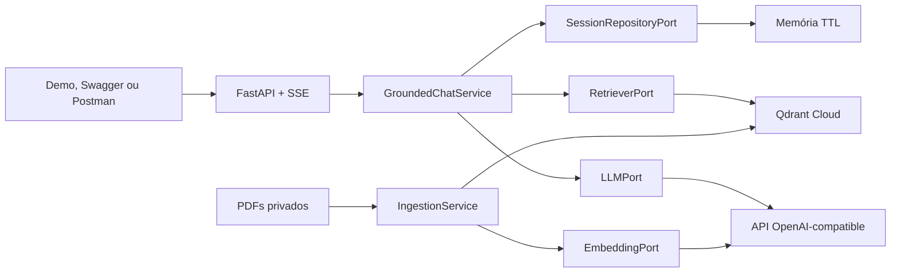

# Desafio Albert — Chatbot RAG

API de chatbot em Python com FastAPI que responde, em streaming, somente com
base em quatro apostilas de saúde mental. A solução usa arquitetura hexagonal,
recuperação semântica no Qdrant, modelos OpenAI-compatible intercambiáveis e
memória temporária de conversa.

O código, os testes e o histórico de decisões foram organizados para que a
solução possa ser explicada e evoluída durante o processo seletivo.

## Estado atual

- API, ingestão, RAG conversacional, SSE e demo estão implementados.
- Os modelos disponíveis são `azure/gpt-5-mini` e `azure/gpt-6-luna`.
- Os embeddings usam `cohere/embed-v4.0`.
- A coleção atual possui 257 páginas indexadas.
- A suíte possui mais de 100 testes e cobertura de branches de 100%.
- O deploy público será realizado na Tarefa 9 do [roadmap](ROADMAP.md).

## Base de conhecimento

Foram utilizadas quatro apostilas fornecidas em uma pasta privada do Google
Drive:

- Saúde Mental na Atenção Primária — 63 páginas;
- Ampliando o Conceito de Saúde Mental — 65 páginas;
- O sujeito, a Integralidade e a Saúde Mental — 53 páginas;
- Desenvolvendo os Cuidados de Saúde Mental na APS — 76 páginas.

Os PDFs não são publicados no GitHub. A ingestão extrai o texto de cada página,
normaliza ruídos de layout, divide textos longos em chunks com sobreposição,
gera IDs e hashes determinísticos, cria embeddings e persiste texto, arquivo,
página e hash no Qdrant. A reingestão consulta os hashes existentes e não
consome embeddings novamente quando o conteúdo não mudou.

## Arquitetura



- `domain`: entidades e regras sem dependências de frameworks;
- `application`: casos de uso, portas, contextualização e avaliação;
- `adapters/inbound`: API FastAPI, SSE e página de demonstração;
- `adapters/outbound`: gateway OpenAI-compatible, Qdrant, PDF e sessões;
- `bootstrap.py`: composição explícita das dependências.

As decisões e alternativas estão registradas em [docs/adr](docs/adr/README.md).

## Fluxo do RAG

1. A pergunta é validada e associada a uma sessão temporária.
2. Perguntas independentes são pesquisadas sem contaminar a consulta com o
   histórico; referências como “isso” ou “ela” usam os turnos recentes.
3. `cohere/embed-v4.0` gera o vetor da consulta.
4. O Qdrant recupera os três trechos mais próximos com score mínimo de `0.35`.
5. Uma página seguinte é incluída para preservar listas e explicações
   interrompidas por quebra de página.
6. O modelo recebe histórico limitado, pergunta e fontes delimitadas como
   conteúdo não confiável.
7. A resposta é transmitida por SSE e deve citar título e página.

O prompt proíbe conhecimento externo, diagnósticos e instruções encontradas
nos documentos. Na ausência de evidência suficiente, o caso de uso recusa a
resposta antes de chamar o modelo quando nenhum trecho supera o limiar.

## Requisitos e instalação

- Python 3.12 ou superior;
- conta/coleção no Qdrant;
- endpoint e chave OpenAI-compatible fornecidos para o desafio.

```bash
python -m venv .venv
```

No Windows:

```powershell
.\.venv\Scripts\Activate.ps1
python -m pip install --upgrade pip
python -m pip install -e ".[dev]"
Copy-Item .env.example .env
```

No Linux ou macOS:

```bash
source .venv/bin/activate
python -m pip install --upgrade pip
python -m pip install -e ".[dev]"
cp .env.example .env
```

Preencha no `.env` pelo menos `OPENAI_BASE_URL`, `OPENAI_API_KEY`,
`QDRANT_URL` e `QDRANT_API_KEY`. As demais opções possuem exemplos seguros em
[.env.example](.env.example).

## Preparação da base

O download e a ingestão são comandos explícitos; iniciar a API não reindexa
documentos nem consome embeddings:

```bash
python scripts/download_documents.py
python scripts/ingest.py
```

O primeiro comando salva os PDFs em `data/documents`, ignorado pelo Git. O
segundo imprime `documents`, `chunks`, `embedded_chunks` e `skipped_chunks`.
Revise o `.env` antes da ingestão, pois novos chunks consomem a cota do gateway.

## Execução e teste manual

```bash
uvicorn chatbot.main:app --reload
```

- Demo: `http://localhost:8000/demo`;
- Swagger: `http://localhost:8000/docs`;
- liveness: `http://localhost:8000/health/live`;
- readiness do Qdrant: `http://localhost:8000/health/ready`;
- coleção Postman: `docs/postman/chatbot-rag.postman_collection.json`.

Exemplo de streaming:

```bash
curl -N -X POST http://localhost:8000/v1/chat/stream \
  -H "Content-Type: application/json" \
  -d '{"session_id":"demo","message":"O que é escuta terapêutica?","model":"azure/gpt-5-mini"}'
```

O endpoint envia `metadata`, um ou mais eventos `token`, `done` e, em falhas
iniciadas após os cabeçalhos HTTP, `error`. O roteiro completo está em
[docs/DEMO.md](docs/DEMO.md).

## API

- `POST /v1/chat/stream`: recebe `session_id`, `message` e `model`;
- `GET /v1/models`: retorna a allowlist de modelos;
- `DELETE /v1/sessions/{session_id}`: apaga o histórico temporário;
- `GET /health/live`: confirma que o processo está ativo;
- `GET /health/ready`: confirma acesso à coleção no Qdrant;
- `GET /demo`: disponibiliza o cliente web mínimo.

`session_id` aceita letras, números, ponto, hífen, sublinhado e dois-pontos,
com até 128 caracteres. Campos extras e modelos fora da allowlist retornam
HTTP 422.

## Qualidade e avaliação

```bash
pytest
ruff check .
mypy
```

A CI executa essas três verificações em Python 3.12. Os testes são offline,
usam fakes/mocks e cobrem adapters, ingestão idempotente, Qdrant, PDFs
inválidos, memória, múltiplos turnos, erros e desconexões de streaming.

O dataset em `evaluation/rag_cases.json` contém perguntas respondíveis,
recusa fora do escopo e conversa com múltiplos turnos. A suíte offline percorre
o `GroundedChatService` e mede recuperação, citação, conceitos essenciais e
recusa sem fazer chamadas pagas.

A avaliação real exige a API em execução e confirmação explícita:

```bash
python scripts/evaluate_rag.py --confirm-live
```

Também são aceitos `--base-url`, `--model` e `--dataset`. Esse comando consome
cota e não é executado pela CI.

## Mídias presentes nas apostilas

Na implementação atual, a ingestão processa somente o texto extraível dos
PDFs. Textos que transcrevem um áudio dentro da própria página são indexados,
mas arquivos de áudio incorporados, destinos de links e conteúdos de vídeos do
YouTube não são acessados nem transcritos.

Uma evolução futura poderá adicionar suporte a essas mídias durante a ingestão,
nunca durante uma pergunta do usuário:

1. Extrair anotações de links e arquivos incorporados, preservando PDF e página
   de origem.
2. Obter legendas ou transcrições já disponíveis nos vídeos.
3. Usar um serviço de transcrição, como Whisper, somente quando não houver
   texto disponível e após avaliar custo, licença e requisitos de execução.
4. Dividir transcrições por intervalos de tempo, gerar embeddings e armazená-las
   no Qdrant com URL, página, título e timestamp.
5. Exibir referências no formato
   `[Título da apostila, p. 29, áudio 00:37]`.

Para manter a arquitetura hexagonal, essa evolução deverá introduzir portas
como `MediaExtractorPort` e `TranscriptionPort`, adaptadores específicos para
PDF, YouTube e transcrição, além de um caso de uso de ingestão multimídia.

Downloads deverão aceitar apenas domínios permitidos, com limites de duração,
tamanho e tempo de resposta para mitigar SSRF e consumo abusivo. Os testes
automatizados usarão mídias simuladas e não dependerão de rede no CI. O
processamento será prévio à publicação, mantendo a API de consulta leve e
compatível com hospedagem gratuita.

## Segurança

Copie `.env.example` para `.env` e preencha as credenciais apenas localmente.
Nunca faça commit de chaves, apostilas em PDF ou índices gerados.

- Credenciais são lidas somente no backend e não chegam à demo.
- Modelos são limitados por allowlist.
- Schemas rejeitam campos extras e limitam tamanho e formato das entradas.
- Logs não incluem chaves nem o conteúdo integral das mensagens.
- Documentos são delimitados como dados não confiáveis contra prompt injection.
- CORS fica desabilitado por padrão e aceita apenas origens explícitas.
- Sessões expiram por TTL e possuem limite de mensagens.

Esta API oferece conteúdo educacional baseado nas apostilas; não substitui
avaliação profissional e não deve realizar diagnóstico médico.

## Custos e desempenho

- A ingestão é offline e idempotente para evitar embeddings repetidos.
- A consulta realiza um embedding e uma geração por pergunta respondível.
- Perguntas sem evidência não chamam o modelo de geração.
- A memória é local ao processo e pode ser perdida em reinícios ou cold starts.
- O Qdrant externo evita reconstruir o índice no ambiente gratuito.
- A avaliação real nunca roda automaticamente.

## Decisões e limitações

- Sessões em memória simplificam a entrega; múltiplas réplicas exigiriam Redis
  ou outro repositório compartilhado.
- A recuperação é vetorial densa, sem reranker ou busca lexical híbrida.
- O limiar `0.35`, `top_k=3` e uma página seguinte foram calibrados com casos
  reais das apostilas e devem ser reavaliados se a base mudar.
- Uma página curta pode corresponder a um chunk; páginas longas são divididas
  conforme `CHUNK_SIZE_TOKENS` e `CHUNK_OVERLAP_TOKENS`.
- O provedor é OpenAI-compatible, mas disponibilidade, latência e limites dos
  modelos continuam sendo responsabilidades externas.
- Áudios e vídeos ainda não são ingeridos, conforme a seção anterior.

## Uso de IA no desenvolvimento

IA generativa foi utilizada como ferramenta de apoio para planejamento,
implementação, criação de testes, revisão de cenários, diagnóstico da
recuperação e redação inicial da documentação. As decisões foram validadas com
execução local, inspeção dos textos realmente armazenados no Qdrant, testes
automatizados, Ruff e mypy.

Não foram delegados à IA segredos, publicação de PDFs ou decisões clínicas. O
desenvolvedor permanece responsável por revisar o código, explicar as escolhas,
validar resultados e controlar chamadas que consomem orçamento.

## Estrutura do projeto

```text
src/chatbot/          aplicação, domínio e adapters
scripts/              download, ingestão e avaliação real
evaluation/           dataset versionado de avaliação
tests/                testes unitários, integração e avaliação offline
docs/adr/             decisões arquiteturais
docs/postman/         coleção para teste manual
ROADMAP.md            tarefas e histórico de execução
```

## Documentação complementar

- [Roadmap e checklist por commit](ROADMAP.md);
- [ADRs](docs/adr/README.md);
- [Roteiro de demonstração e troubleshooting](docs/DEMO.md).
