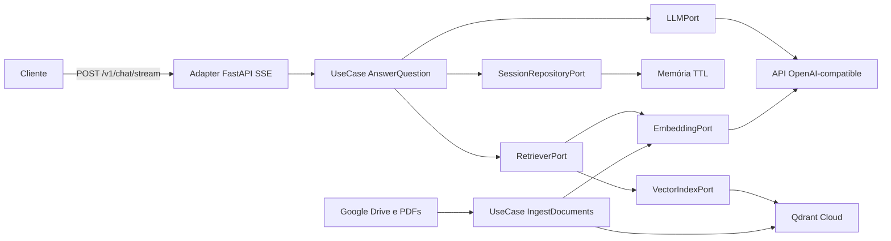

# Roadmap — Chatbot RAG

API FastAPI em arquitetura hexagonal, com RAG persistido no Qdrant, streaming
SSE, seleção de modelos OpenAI-compatible e memória de sessão no backend.

## Arquitetura-alvo

- `domain`: entidades e regras puras, sem dependências de infraestrutura.
- `application`: casos de uso e portas de entrada e saída.
- `adapters/inbound`: FastAPI, schemas, SSE e página de demonstração.
- `adapters/outbound`: OpenAI-compatible, Qdrant, PDFs e sessões em memória.
- `bootstrap.py`: composição e injeção explícita das dependências.

## Contratos planejados

- `POST /v1/chat/stream`: `session_id`, `message` e `model`; eventos
  `metadata`, `token`, `done` e `error`.
- `GET /v1/models`: lista dos modelos autorizados.
- `DELETE /v1/sessions/{session_id}`: remove o histórico temporário.
- `GET /health/live` e `GET /health/ready`: saúde do processo e dependências.
- `GET /demo`: chat mínimo com streaming, fontes, modelo e sessão.

## Decisões principais

- Qdrant Cloud gratuito evita reindexação em cada cold start do Render.
- A ingestão é offline e idempotente por hash; PDFs não entram no Git.
- O histórico fica em memória, com TTL e limites. A porta permitirá trocar por
  Redis sem alterar os casos de uso.
- O RAG reformula perguntas de acompanhamento, aplica limiar de relevância,
  exige fontes e recusa respostas sem evidência suficiente.
- Documentos são conteúdo não confiável: instruções encontradas neles são
  ignoradas e o contexto é delimitado no prompt.
- Swagger cobre contratos comuns; `/demo` é a apresentação principal;
  Postman e `curl -N` validam o streaming de forma independente.
- A CI usa fakes e mocks; chamadas pagas ficam restritas à ingestão e às
  avaliações manuais controladas.
- Cobertura de branches mínima de 90%, sem substituir testes comportamentais.

## Checklist por Tarefa

### Tarefa 1 — `chore: bootstrap project and quality gates`

- [x] Criar o repositório público no GitHub e configurar `origin` e `main`.
- [x] Inicializar Python 3.12, layout `src` e gerenciamento de dependências.
- [x] Adicionar `.gitignore`, `.env.example`, licença e configurações.
- [x] Configurar Ruff, análise de tipos, pytest e cobertura de branches ≥90%.
- [x] Criar GitHub Actions para push e pull request.
- [x] Adicionar aplicação e teste mínimos para validar o pipeline.
- [x] Confirmar ausência de chaves, PDFs e arquivos sensíveis.

### Tarefa 2 — `feat: add domain and application ports`

- [x] Criar `Message`, `ChatSession`, `DocumentChunk` e `Citation`.
- [x] Definir exceções e regras de domínio.
- [x] Definir portas para LLM, embeddings, recuperação e sessões.
- [x] Criar `AnswerQuestion`, `IngestKnowledgeBase` e `ListModels`.
- [x] Implementar fakes determinísticos de teste.
- [x] Cobrir regras e contratos com testes unitários.
- [x] Impedir imports de FastAPI, OpenAI e Qdrant no núcleo.

### Tarefa 3 — `feat: add idempotent knowledge ingestion`

- [x] Baixar apostilas sem armazená-las no Git.
- [x] Extrair e limpar texto preservando arquivo, título e página.
- [x] Implementar chunks por tokens, sobreposição e IDs determinísticos.
- [x] Integrar embeddings `cohere/embed-v4.0` com batching e retry.
- [x] Integrar Qdrant e versionar a coleção.
- [x] Evitar embeddings repetidos por hash.
- [x] Criar `scripts/ingest.py` com validação e resumo.
- [x] Testar todo o pipeline sem chamadas reais.

### Tarefa 4 — `feat: add grounded conversational rag`

- [x] Criar sessões em memória com TTL e limites.
- [x] Contextualizar perguntas com o histórico recente.
- [x] Recuperar com `top_k`, filtros e limiar configuráveis.
- [x] Criar prompt delimitado com política de recusa.
- [x] Vincular citações a apostila e página.
- [x] Implementar chat OpenAI-compatible assíncrono e intercambiável.
- [x] Testar contexto, recusa, citações, modelos e prompt injection.

### Tarefa 5 — `feat: expose streaming chat api`

- [x] Criar composition root com injeção explícita.
- [x] Implementar chat com SSE.
- [x] Implementar modelos e allowlist.
- [x] Implementar sessões e health checks.
- [x] Validar entrada e padronizar erros.
- [x] Tratar desconexões, cancelamento e timeouts.
- [x] Configurar OpenAPI, CORS e logs seguros.
- [x] Testar HTTP e sequência SSE.

### Tarefa 6 — `feat: add live demo and api test collection`

- [x] Criar `/demo` sem framework frontend.
- [x] Consumir o `ReadableStream` incrementalmente.
- [x] Adicionar modelo, sessão e estados de erro.
- [x] Exibir resposta e fontes de forma acessível.
- [x] Garantir que nenhuma chave chegue ao navegador.
- [x] Criar coleção Postman e exemplos `curl -N`.
- [x] Testar rota, assets e comportamento essencial.

### Tarefa 7 — `test: add integration and rag evaluation suites`

- [x] Testar adapters OpenAI-compatible e Qdrant isoladamente.
- [x] Testar streaming parcial, falhas e desconexões.
- [x] Testar reingestão, PDFs inválidos e dependências indisponíveis.
- [x] Criar dataset com perguntas respondíveis, recusas e múltiplos turnos.
- [x] Avaliar recuperação, citações, groundedness e recusa.
- [x] Separar testes offline de avaliações reais.
- [x] Atingir cobertura de branches ≥90%.
- [x] Validar suíte, lint e tipos.

### Tarefa 8 — `docs: add architecture usage and ai disclosure`

- [x] Documentar objetivo, escopo, arquitetura e fluxo RAG.
- [x] Documentar instalação, configuração, ingestão, execução e testes.
- [x] Documentar API, Swagger, demo, Postman e `curl`.
- [x] Descrever as apostilas e seu processamento sem publicá-las.
- [x] Registrar decisões, alternativas, trade-offs e limitações.
- [x] Explicar segurança, custos, avaliação e cobertura.
- [x] Relatar de forma transparente o uso de IA.
- [x] Criar ADRs para as decisões relevantes.
- [x] Adicionar roteiro de demonstração e troubleshooting.

### Tarefa 9 — `deploy: configure render service`

- [x] Criar e validar Dockerfile executado como usuário não-root.
- [x] Criar `render.yaml` com health check.
- [x] Configurar segredos somente no Render e Qdrant.
- [x] Executar ingestão idempotente e validar a coleção.
- [x] Publicar e registrar a URL no README.
- [x] Executar smoke test completo.
- [x] Validar e documentar o cold start.
- [x] Confirmar CI, cobertura e histórico sem segredos.

### Tarefa 10 — `refactor: isolate rag policies from infrastructure`

- [x] Desacoplar o router HTTP do composition root.
- [x] Centralizar a composição da API e da ingestão no `bootstrap.py`.
- [x] Mover grounding e montagem do prompt para a aplicação.
- [x] Separar recuperação semântica do adapter Qdrant.
- [x] Injetar a codificação de tokens por uma porta.
- [x] Persistir títulos como metadados e migrar os 257 chunks existentes.
- [x] Atualizar README, ADRs e testes automatizados.
- [x] Validar 100% de cobertura, Ruff e análise de tipos.

## Escalabilidade (evolução)

Hoje cada conversa envia `session_id` em `POST /v1/chat/stream`. A API abre um
canal SSE por requisição e devolve tokens à medida que o modelo os gera. O
Uvicorn é assíncrono: várias conexões convivem no mesmo event loop, cada uma
com o próprio histórico, recuperação no Qdrant e chamada ao gateway.

Não há fila global de respostas. O que serializa o tráfego, na prática, são os
limites da instância (Render Free, `WEB_CONCURRENCY=1`), da cota compartilhada
do LLM/embeddings e do Qdrant. Sessões ficam em memória do processo; várias
réplicas quebrariam o contexto entre turnos até existir um repositório
compartilhado.

O teste de carga abaixo mede esse comportamento **antes** de autenticar
usuários de verdade. Se os números não forem aceitáveis, a correção segue a
ordem: identificar o gargalo, aplicar backpressure e só então escalar
infraestrutura.

### Tarefa 11 — `test: add load test and scale-out plan`

- [x] Documentar o modelo atual: uma conexão SSE por pergunta, multiplexação
      assíncrona, sessão em memória e dependência do gateway.
- [x] Definir o cenário-alvo: usuários simultâneos, perguntas por minuto, tempo
      até o primeiro token, taxa de erro e percentual de streams concluídos.
- [x] Criar um teste de carga local contra a API com LLM e retriever fake,
      para medir a aplicação sem gastar a cota.
- [x] Criar um perfil controlado contra o ambiente publicado, com teto de
      cinco requisições reais.
- [x] Registrar p50/p95 de primeiro token, duração do stream e 4xx/5xx.
- [x] Diagnosticar o gargalo: a API local passou; em produção o limite é o
      gateway e a sessão em memória, não o event loop.
- [x] Mitigação imediata: `MAX_CONCURRENT_STREAMS` com HTTP 429 e
      `STREAM_TIMEOUT_SECONDS` antes de o SSE ficar aberto indefinidamente.
- [ ] Mitigação de sessão: persistir histórico em Redis via
      `SessionRepositoryPort`, para várias réplicas compartilharem o contexto.
- [ ] Mitigação de capacidade: aumentar `WEB_CONCURRENCY` ou o plano do Render
      somente depois de o histórico deixar a memória do processo.
- [ ] Mitigação de custo: cache de embeddings de consultas repetidas.
- [x] Publicar o relatório no README e no ADR 0005.

## Observabilidade (evolução)

Hoje há liveness, readiness do Qdrant e quatro logs de erro no adapter HTTP.
`LOG_LEVEL` existe no `Settings`, mas não configura o processo. Não há
`request_id`, métricas do gate/RAG nem rastreio das etapas de uma pergunta.

O destino escolhido é OpenTelemetry com Grafana Cloud. A API exporta OTLP
direto, sem Grafana, Loki nem Alloy no Render Free. Spans são manuais e sem
autoinstrumentação, para não vazar mensagem, prompt ou chunks das apostilas.
O SDK fica no `bootstrap.py` e num adapter; domínio e casos de uso não
importam OpenTelemetry. Sem endpoint configurado, a API sobe normalmente.

### Tarefa 12 — `docs: record otel grafana cloud decision`

- [x] Criar o ADR 0006: OTel + Grafana Cloud, OTLP direto, fail-open e
      amostragem (100% em desenvolvimento, 10–20% em produção).
- [x] Registrar alternativas descartadas: só logs no Render, Prometheus
      scrape, Datadog/New Relic, Grafana self-hosted e Alloy no Free.
- [x] Definir o contrato de privacidade: nada de `message`, prompt, chunks
      nem chaves; `session_id` só hasheado; um span de geração, não um por
      token.
- [x] Atualizar `docs/adr/README.md` com o novo registro.

### Tarefa 13 — `feat: add observability port and json logs`

- [x] Ligar `LOG_LEVEL` na inicialização do processo.
- [x] Emitir logs JSON no stdout, adequados ao coletor do Render.
- [x] Gerar `request_id` no adapter HTTP e devolver o cabeçalho
      `X-Request-ID`.
- [x] Criar a porta de observabilidade e um adapter sem backend; o núcleo
      não importa OpenTelemetry, FastAPI nem Grafana.
- [x] Registrar admissão do stream, HTTP 429, timeout, desconexão, recusa
      por evidência insuficiente e erro interno.
- [x] Testar o adapter com fake; a CI continua sem rede nem Grafana.

### Tarefa 14 — `feat: instrument rag pipeline and export otlp`

- [x] Instrumentar spans manuais: `chat.stream`, `retrieval`, `embed`,
      `qdrant` e `llm`.
- [x] Anexar só atributos de operação: modelo, `top_k`, melhor score,
      recusa, tempo até o primeiro token e `session_id` hasheado.
- [x] Expor métricas: streams ativos versus `MAX_CONCURRENT_STREAMS`, 429,
      recusas, p95 até o primeiro token e latência Qdrant/LLM.
- [x] Exportar OTLP quando `OTEL_EXPORTER_OTLP_ENDPOINT` e
      `OTEL_EXPORTER_OTLP_HEADERS` existirem; sem eles, não exportar.
- [x] Compor o SDK somente no `bootstrap.py`; testes usam NoOp ou fake.
- [x] Incluir as variáveis no `.env.example` e como `sync: false` no
      `render.yaml`.
- [x] Documentar no README e no DEMO como correlacionar um stream com o
      trace no Grafana Cloud.
- [x] Validar Ruff, mypy e cobertura de branches ≥90%.

## Frontend React (evolução)

O chat de hoje é o `demo.html`, servido em `GET /demo` pelo próprio FastAPI.
O navegador fala com a API na mesma origem, então o CORS não entra nesse
fluxo. O middleware já existe e só liga quando `CORS_ORIGINS` lista origens
explícitas: métodos `GET`, `POST` e `DELETE`, cabeçalhos `Content-Type` e
`X-Request-ID`, `X-Request-ID` exposto e credenciais desligadas. Vazio, o
middleware fica de fora. Em produção a variável não está no Render, e a suíte
só cobre o preflight de `GET /v1/models`.

O cliente novo é um projeto React no mesmo repositório, em `frontend/`, e
consome a API já publicada. A hospedagem final é a Vercel, em outra origem.
Essa URL é o que falta para concluir o CORS: a allowlist passa a ter um
consumidor real, continua explícita e não abre `*`.

O núcleo Python não muda de papel. O React só chama `GET /v1/models`,
`POST /v1/chat/stream` e `DELETE /v1/sessions/{session_id}`. Nenhuma chave
entra no bundle. Vite, React e TypeScript, sem biblioteca de UI: o visual
atual (tema claro/escuro, fontes, sessão e layout estreito) permanece em CSS.
SSR não entra, porque a página é um cliente do SSE.

As práticas repetem as da API. TypeScript estrito e ESLint no lugar de mypy e
Ruff. Vitest e Testing Library no lugar do pytest: um comportamento por
teste, arrange/act/assert visíveis, fetch simulado e suíte offline. Cobertura
de branches ≥90% no `frontend/`, medida à parte da cobertura Python. A CI ganha
um job que não depende de Qdrant, gateway nem segredos.

O `demo.html` permanece até o app da Vercel ser a entrada documentada. Depois
saem a rota `/demo`, o HTML e os testes que o prendem ao pacote Python.

### Tarefa 15 — `chore: bootstrap react client and quality gates`

- [x] Criar `frontend/` com Vite, React e TypeScript estrito.
- [x] Configurar ESLint, Vitest, Testing Library e cobertura de branches ≥90%.
- [x] Adicionar job de CI só do frontend, sem rede e sem segredos.
- [x] Publicar `frontend/.env.example` com `VITE_API_BASE_URL` e sem chaves.
- [x] Ignorar `node_modules` e artefatos de build.

### Tarefa 16 — `feat: add react chat client`

- [x] Carregar a allowlist em `GET /v1/models` e tratar falha sem habilitar envio.
- [x] Enviar `session_id`, `message` e `model` em `POST /v1/chat/stream`.
- [x] Ler o SSE aos poucos: `metadata`, `token`, `done` e `error`.
- [x] Agrupar citações por título e intervalo de páginas, como no HTML.
- [x] Encerrar a sessão em `DELETE /v1/sessions/{session_id}` e abrir outra.
- [x] Manter estados de espera, erro, foco e `aria-live`.
- [x] Limitar a mensagem a 4000 caracteres e não interpolar segredo no bundle.
- [x] Testar cada comportamento com API simulada, um caso por teste.

### Tarefa 17 — `feat: close cors for the browser client`

- [x] Documentar a origem local `http://localhost:5173` para o desenvolvimento.
- [x] Cobrir o preflight de `POST /v1/chat/stream` com `Content-Type` e
      `X-Request-ID`, além da resposta do stream.
- [x] Manter origem desconhecida sem `Access-Control-Allow-Origin` e
      credenciais desligadas.
- [x] Registrar no Render, em `CORS_ORIGINS`, somente
      `https://desafio-albert.vercel.app`. Previews `*.vercel.app` ficam de fora.
- [x] Deixar a variável vazia no exemplo versionado; produção não usa `*`.

### Tarefa 18 — `deploy: publish frontend on vercel`

- [x] Apontar o projeto da Vercel para `frontend/`, com build estático do Vite.
      O endereço é <https://desafio-albert.vercel.app/>.
- [x] Definir `VITE_API_BASE_URL` com a URL do Render e nenhuma credencial.
- [ ] Preencher `CORS_ORIGINS` no serviço já publicado e repetir o smoke a
      partir do navegador. O `render.yaml` já traz a origem; o processo no ar
      ainda não a aplica.
- [ ] Validar modelos, stream, fontes, erro e nova conversa na URL da Vercel.
- [x] Atualizar README e DEMO com a URL, o CORS e o desenvolvimento local.
- [ ] Remover `/demo`, `demo.html` e os testes do HTML depois do corte.
- [ ] Confirmar que o GitHub segue sem `node_modules`, segredos ou PDFs.

## Critérios de aceite

- Tokens são entregues antes de a resposta terminar.
- Os dois modelos usam o mesmo endpoint e nomes inválidos são rejeitados.
- Respostas têm fontes; evidência insuficiente gera recusa.
- A sessão mantém o contexto sem permitir crescimento ilimitado.
- Reingestão sem mudanças não recria embeddings.
- CI passa em lint, tipos, testes e cobertura de branches ≥90%.
- Demo, Swagger, Postman e `curl` permitem testar a aplicação publicada.
- O cliente React na Vercel consome a API publicada; o CORS aceita só essa
  origem e permanece desligado quando a lista está vazia.
- README e ADRs permitem explicar decisões, alternativas e uso de IA.
- GitHub não contém segredos, PDFs ou dados sensíveis.
- Telemetria não contém texto da conversa nem segredos; a API sobe sem
  Grafana Cloud configurado.
