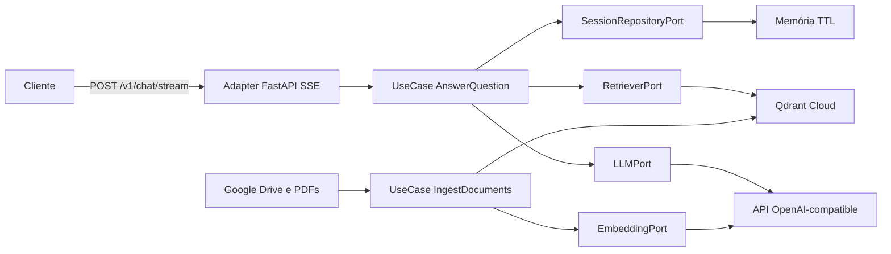

# Roadmap — Chatbot RAG

API FastAPI em arquitetura hexagonal, com RAG persistido no Qdrant, streaming
SSE, seleção de modelos OpenAI-compatible e memória de sessão no backend.

## Arquitetura-alvo

- `domain`: entidades e regras puras, sem dependências de infraestrutura.
- `application`: casos de uso e portas de entrada e saída.
- `adapters/inbound`: FastAPI, schemas, SSE e página de demonstração.
- `adapters/outbound`: OpenAI-compatible, Qdrant, PDFs e sessões em memória.
- `bootstrap.py`: composição e injeção explícita das dependências.

## Contratos planejados

- `POST /v1/chat/stream`: `session_id`, `message` e `model`; eventos
  `metadata`, `token`, `done` e `error`.
- `GET /v1/models`: lista dos modelos autorizados.
- `DELETE /v1/sessions/{session_id}`: remove o histórico temporário.
- `GET /health/live` e `GET /health/ready`: saúde do processo e dependências.
- `GET /demo`: chat mínimo com streaming, fontes, modelo e sessão.

## Decisões principais

- Qdrant Cloud gratuito evita reindexação em cada cold start do Render.
- A ingestão é offline e idempotente por hash; PDFs não entram no Git.
- O histórico fica em memória, com TTL e limites. A porta permitirá trocar por
  Redis sem alterar os casos de uso.
- O RAG reformula perguntas de acompanhamento, aplica limiar de relevância,
  exige fontes e recusa respostas sem evidência suficiente.
- Documentos são conteúdo não confiável: instruções encontradas neles são
  ignoradas e o contexto é delimitado no prompt.
- Swagger cobre contratos comuns; `/demo` é a apresentação principal;
  Postman e `curl -N` validam o streaming de forma independente.
- A CI usa fakes e mocks; chamadas pagas ficam restritas à ingestão e às
  avaliações manuais controladas.
- Cobertura de branches mínima de 90%, sem substituir testes comportamentais.

## Checklist por Tarefa

### Tarefa 1 — `chore: bootstrap project and quality gates`

- [x] Criar o repositório público no GitHub e configurar `origin` e `main`.
- [x] Inicializar Python 3.12, layout `src` e gerenciamento de dependências.
- [x] Adicionar `.gitignore`, `.env.example`, licença e configurações.
- [x] Configurar Ruff, análise de tipos, pytest e cobertura de branches ≥90%.
- [x] Criar GitHub Actions para push e pull request.
- [x] Adicionar aplicação e teste mínimos para validar o pipeline.
- [x] Confirmar ausência de chaves, PDFs e arquivos sensíveis.

### Tarefa 2 — `feat: add domain and application ports`

- [x] Criar `Message`, `ChatSession`, `DocumentChunk` e `Citation`.
- [x] Definir exceções e regras de domínio.
- [x] Definir portas para LLM, embeddings, recuperação e sessões.
- [x] Criar `AnswerQuestion`, `IngestKnowledgeBase` e `ListModels`.
- [x] Implementar fakes determinísticos de teste.
- [x] Cobrir regras e contratos com testes unitários.
- [x] Impedir imports de FastAPI, OpenAI e Qdrant no núcleo.

### Tarefa 3 — `feat: add idempotent knowledge ingestion`

- [x] Baixar apostilas sem armazená-las no Git.
- [x] Extrair e limpar texto preservando arquivo, título e página.
- [x] Implementar chunks por tokens, sobreposição e IDs determinísticos.
- [x] Integrar embeddings `cohere/embed-v4.0` com batching e retry.
- [x] Integrar Qdrant e versionar a coleção.
- [x] Evitar embeddings repetidos por hash.
- [x] Criar `scripts/ingest.py` com validação e resumo.
- [x] Testar todo o pipeline sem chamadas reais.

### Tarefa 4 — `feat: add grounded conversational rag`

- [x] Criar sessões em memória com TTL e limites.
- [x] Contextualizar perguntas com o histórico recente.
- [x] Recuperar com `top_k`, filtros e limiar configuráveis.
- [x] Criar prompt delimitado com política de recusa.
- [x] Vincular citações a apostila e página.
- [x] Implementar chat OpenAI-compatible assíncrono e intercambiável.
- [x] Testar contexto, recusa, citações, modelos e prompt injection.

### Tarefa 5 — `feat: expose streaming chat api`

- [x] Criar composition root com injeção explícita.
- [x] Implementar chat com SSE.
- [x] Implementar modelos e allowlist.
- [x] Implementar sessões e health checks.
- [x] Validar entrada e padronizar erros.
- [x] Tratar desconexões, cancelamento e timeouts.
- [x] Configurar OpenAPI, CORS e logs seguros.
- [x] Testar HTTP e sequência SSE.

### Tarefa 6 — `feat: add live demo and api test collection`

- [x] Criar `/demo` sem framework frontend.
- [x] Consumir o `ReadableStream` incrementalmente.
- [x] Adicionar modelo, sessão e estados de erro.
- [x] Exibir resposta e fontes de forma acessível.
- [x] Garantir que nenhuma chave chegue ao navegador.
- [x] Criar coleção Postman e exemplos `curl -N`.
- [x] Testar rota, assets e comportamento essencial.

### Tarefa 7 — `test: add integration and rag evaluation suites`

- [x] Testar adapters OpenAI-compatible e Qdrant isoladamente.
- [x] Testar streaming parcial, falhas e desconexões.
- [x] Testar reingestão, PDFs inválidos e dependências indisponíveis.
- [x] Criar dataset com perguntas respondíveis, recusas e múltiplos turnos.
- [x] Avaliar recuperação, citações, groundedness e recusa.
- [x] Separar testes offline de avaliações reais.
- [x] Atingir cobertura de branches ≥90%.
- [x] Validar suíte, lint e tipos.

### Tarefa 8 — `docs: add architecture usage and ai disclosure`

- [x] Documentar objetivo, escopo, arquitetura e fluxo RAG.
- [x] Documentar instalação, configuração, ingestão, execução e testes.
- [x] Documentar API, Swagger, demo, Postman e `curl`.
- [x] Descrever as apostilas e seu processamento sem publicá-las.
- [x] Registrar decisões, alternativas, trade-offs e limitações.
- [x] Explicar segurança, custos, avaliação e cobertura.
- [x] Relatar de forma transparente o uso de IA.
- [x] Criar ADRs para as decisões relevantes.
- [x] Adicionar roteiro de demonstração e troubleshooting.

### Tarefa 9 — `deploy: configure render service`

- [ ] Criar e validar Dockerfile executado como usuário não-root.
- [ ] Criar `render.yaml` com health check.
- [ ] Configurar segredos somente no Render e Qdrant.
- [ ] Executar ingestão idempotente e validar a coleção.
- [ ] Publicar e registrar a URL no README.
- [ ] Executar smoke test completo.
- [ ] Validar e documentar o cold start.
- [ ] Confirmar CI, cobertura e histórico sem segredos.

## Critérios de aceite

- Tokens são entregues antes de a resposta terminar.
- Os dois modelos usam o mesmo endpoint e nomes inválidos são rejeitados.
- Respostas têm fontes; evidência insuficiente gera recusa.
- A sessão mantém o contexto sem permitir crescimento ilimitado.
- Reingestão sem mudanças não recria embeddings.
- CI passa em lint, tipos, testes e cobertura de branches ≥90%.
- Demo, Swagger, Postman e `curl` permitem testar a aplicação publicada.
- README e ADRs permitem explicar decisões, alternativas e uso de IA.
- GitHub não contém segredos, PDFs ou dados sensíveis.
